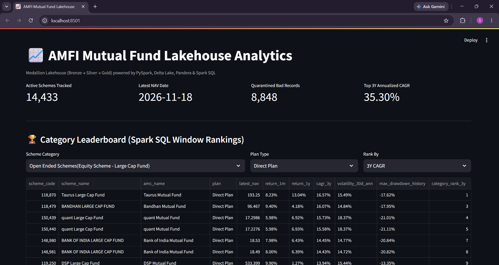

# AMFI Mutual Fund Lakehouse

[](https://github.com/bsaee/AMFI-Lakehouse/actions/workflows/ci.yml)
[](https://github.com/bsaee/AMFI-Lakehouse/actions/workflows/daily.yml)

An end-to-end, automated Data Engineering pipeline that ingests daily and historical Net Asset Value (NAV) data from the Association of Mutual Funds in India (AMFI), processes **6.01M+ historical records** across **14,433 mutual fund schemes** through a **Bronze → Silver → Gold** medallion architecture on **Delta Lake** using **PySpark**, enforces schema and drift contracts with **Pandera**, and serves risk/return analytics via **Spark SQL** and **Streamlit**.

---

## Architecture

```text
AMFI Portal (Daily NAVAll.txt + 90-Day Historical Backfill Windows)
       │
       ▼
┌───────────────────────────────────────────────────────────────────────┐
│ BRONZE LAYER (Immutable Raw Landing)                                  │
│ • Date-partitioned raw files (ingestion_date=YYYY-MM-DD)              │
│ • Exponential-backoff HTTP retries + SHA-256 checksum idempotency     │
└──────────────────────────────────┬────────────────────────────────────┘
                                   │ Stateful Multi-Header Parser
                                   ▼
┌───────────────────────────────────────────────────────────────────────┐
│ DATA QUALITY & OBSERVABILITY (Pandera + PySpark Guardrails)           │
│ • Schema, null, range (0 < NAV < 1e6), date bounds & batch dedupe     │
│ • Row-count & drift guardrails against silent upstream truncation     │
│ • Bad records routed to Delta Quarantine table with explicit reasons  │
└──────────────┬────────────────────────────────────┬───────────────────┘
               │ Valid Rows                         │ Anomalous Rows
               ▼                                    ▼
┌──────────────────────────────────────┐  ┌─────────────────────────────┐
│ SILVER LAYER (Delta Star Schema)     │  │ SILVER QUARANTINE (Delta)   │
│ • nav_daily (Fact, year_month part.) │  │ • 8,848 bad rows isolated   │
│ • scheme_dim (Dimension)             │  │   (N.A. & zero-NAV NFOs)    │
│ • ACID Delta MERGE upserts           │  └─────────────────────────────┘
└──────────────┬───────────────────────┘
               │ Spark SQL Window Functions (LAG, STDDEV, MAX, DENSE_RANK)
               ▼
┌───────────────────────────────────────────────────────────────────────┐
│ GOLD LAYER (Analytics & Serving)                                      │
│ • fund_daily_metrics: Daily return, 30D rolling volatility, drawdown  │
│ • category_leaderboard: 1M/1Y/3Y CAGR & category rankings             │
└──────────────────────────────────┬────────────────────────────────────┘
                                   │
                    ┌──────────────┴──────────────┐
                    ▼                             ▼
       Streamlit Analytics UI        GitHub Actions Cron + Releases
       (Zero-JVM Delta Reader)       (Automated Daily Runs & State)
```

---

## Dashboard Preview



---

## Measured Pipeline Benchmarks

| Stage | Metric | Measured Result |
| :--- | :--- | :--- |
| **Bronze Daily Ingestion** | Daily `NAVAll.txt` volume & speed | **18,281 lines (1.46 MB)** in **0.77s** (SHA-256 idempotent skip in **0.65s**) |
| **Historical Backfill** | 3.1-year window backfill (Oct 2023 – Nov 2026) | **13 chunks (<=90-day windows)**, **6,112,483 raw lines (~770 MB)** |
| **Silver Fact (`nav_daily`)** | Clean historical NAV observations | **6,014,674 rows** partitioned by `year_month` |
| **Silver Dim (`scheme_dim`)** | Distinct mutual fund schemes tracked | **14,433 schemes** (with AMC, Category, Plan, Option & ISINs) |
| **Data Quality Quarantine** | Anomalous records isolated (`quarantine`) | **8,848 historical / 253 daily rows** (`"N.A."` & `0.0000` NFO NAVs) |
| **Gold Analytics (`Spark SQL`)** | Window metrics across full 3.1Y history | **6,014,674 metric rows** + **14,433 leaderboard rows** in **251.75s** |

---

## Key Architectural Decisions (Design Trade-offs)

1. **Stateful Line Parser for Multi-Header Feeds (`parse.py`):** AMFI's semicolon-delimited text files interleave Scheme Category headers, AMC headers, and fund data rows—and differ in column order between daily (`NAVAll.txt`) and historical (`DownloadNAVHistoryReport_Po.aspx`) endpoints. A stateful parser dynamically detects header schemas and propagates category/AMC context onto every fund record.
2. **Quarantine Table Over Hard Failure (`quality.py`):** Upstream AMFI feeds regularly contain ~250 daily rows with `"N.A."` or `0.0000` NAVs (newly launched NFOs). Quarantining invalid records into a separate Delta table with an explicit `quarantine_reason` prevents division-by-zero errors in Gold return math without blocking 14,200+ valid funds.
3. **Parquet Staging + Monthly Partitioning (`silver.py`):** Streaming parsed backfill chunks to Snappy-compressed Parquet staging before Spark ingestion avoids driver OOM on memory-constrained environments, while partitioning `nav_daily` by `year_month` (~38 partitions) instead of `nav_date` (~750 partitions) prevents the small-files problem.
4. **Zero-JVM Serving & Serverless State Persistence:** Streamlit reads Gold Delta tables directly via `deltalake` (Arrow/Parquet) in `<50ms` without spinning up a JVM, while GitHub Actions persists incremental Delta state between stateless cron runners via compressed GitHub Release assets (`lakehouse-latest`).

---

## Project Structure

```text
amfi-lakehouse/
├── .github/workflows/
│   ├── ci.yml               # pytest unit & PySpark quality suite on push/PR
│   └── daily.yml            # Mon-Fri 11:00 PM IST cron ETL + Release state sync
├── dashboard/
│   └── app.py               # Streamlit leaderboard & fund risk/return explorer
├── docs/
│   └── dashboard_preview.png
├── src/amfi_lakehouse/
│   ├── config.py            # Centralized paths, URLs & HTTP retry settings
│   ├── ingest.py            # Idempotent daily & 90-day window historical ingestion
│   ├── parse.py             # Stateful multi-header & multi-layout AMFI parser
│   ├── quality.py           # Pandera schema validation, drift checks & quarantine
│   ├── silver.py            # Star-schema transformation & Delta MERGE upserts
│   ├── gold.py              # Spark SQL window analytics (returns, volatility, drawdown)
│   ├── pipeline.py          # End-to-end daily Bronze -> Silver -> Gold orchestrator
│   └── spark_session.py     # Cross-platform Spark + Delta session builder
├── tests/
│   ├── test_parser.py
│   └── test_quality_and_silver.py
├── METRICS.md
├── README.md
└── requirements.txt
```

---

## Quickstart

```bash
# 1. Create & activate Python 3.11 virtual environment
python -m venv .venv
source .venv/bin/activate  # On Windows: .\.venv\Scripts\Activate.ps1

# 2. Install dependencies
pip install -r requirements.txt

# 3. Run unit & Spark quality tests
PYTHONPATH=src pytest -v

# 4. Run daily Bronze -> Silver -> Gold pipeline
PYTHONPATH=src python -m amfi_lakehouse.pipeline

# 5. Launch Streamlit dashboard
streamlit run dashboard/app.py
```